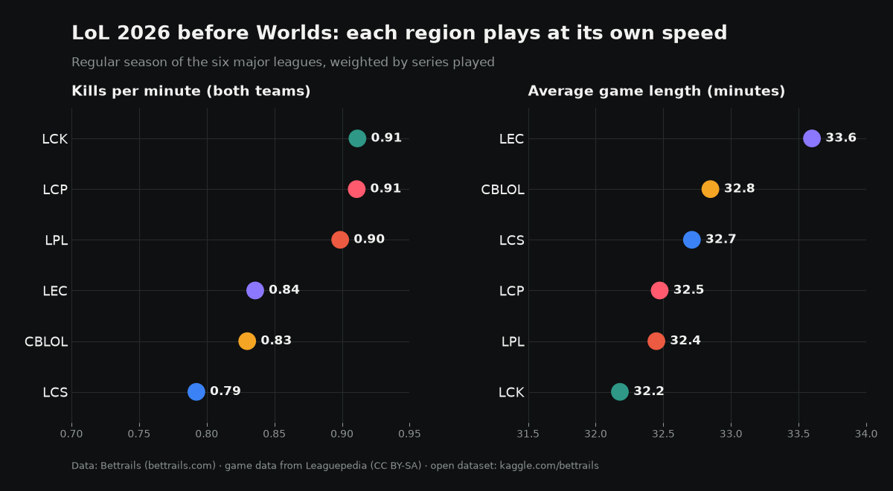

# Esports Stats 2026: LoL Pro Leagues & eSoccer

Open, ready-to-use statistics from **Bettrails** (https://bettrails.com), an independent esports analytics lab. Two tables:

1. **League of Legends 2026 — team standings and game pace** for the six major pro leagues (LCK, LPL, LEC, LCS, CBLOL, LCP). Worlds 2026 (October 15 – November 14, United States) will be added as it is played.
2. **eSoccer (virtual football, EA SPORTS FC) — monthly summary by league** for nine leagues, covering **603,952 finished matches** from January 2025 to October 2026.

No betting odds are included. All figures are aggregates of real, finished matches.

## Files

### `lol_2026_team_standings.csv` (60 teams)

| Column | Description |
|---|---|
| `league` | League code (LCK, LPL, LEC, LCS, CBLOL, LCP) |
| `league_name` | Full league name |
| `region` | Region of the league |
| `team` | Team name |
| `series_played` | Finished series in the 2026 season |
| `series_wins` / `series_losses` | Series won / lost |
| `series_win_pct` | Share of series won (%) |
| `combined_kills_per_minute` | Kills by both teams per minute of game time, averaged over the team's games |
| `avg_game_duration_min` | Average game length, in minutes |
| `last_results` | Last five series, oldest to newest (W = win, L = loss) |

Live version with schedules and team pages: https://bettrails.com/lol/

### `esoccer_monthly_league_stats.csv` (one row per league and month)

| Column | Description |
|---|---|
| `league_code` / `league_name` | League (GT Leagues, Esports Battle, Esports Battle Volta 3v3, eRivals, Adriatic League, Cyber Live Arena, GG League, Valhalla Cup, Valkyrie Cup) |
| `month` | Calendar month (YYYY-MM) |
| `is_partial_month` | 1 if the month was still in progress when the file was generated |
| `matches` | Finished matches with a final score |
| `avg_total_goals` | Average goals per match (both sides) |
| `avg_home_goals` / `avg_away_goals` | Average goals of the side listed first / second |
| `home_win_pct` / `draw_pct` / `away_win_pct` | Share of results (%) |
| `both_teams_scored_pct` | Share of matches where both sides scored (%) |
| `max_total_goals` | Highest-scoring match of the month |

Months with fewer than 30 matches (the first days of a league) are left out, and so are impossible scores (more than 30 goals in a match, i.e. data-entry errors). Live results, player rankings and head-to-head records: https://bettrails.com/hoy

## Sources and license

- League of Legends data: game records from [Leaguepedia](https://lol.fandom.com), licensed CC BY-SA 3.0, aggregated by Bettrails. Bettrails is not affiliated with Riot Games.
- eSoccer data: final scores published by each league, collected and aggregated by Bettrails.

This dataset is released under **CC BY-SA 4.0**. Please credit **Bettrails (https://bettrails.com)** when you use it.

## Updates

Generated on 2026-10-07 (version 2: one impossible 43-57 score removed and late results added). Bettrails updates the source data continuously; this file will be refreshed periodically, and Worlds 2026 results will be added during the event.

## Suggested uses

- Compare pace and dominance across the six LoL regions before Worlds 2026.
- Study how scoring and draw rates differ between eSoccer formats (1v1 vs 3v3 Volta) and how they evolve month by month.
- Teaching material for data visualization and sports analytics.

## Where to find it

- Kaggle (with an example notebook): https://www.kaggle.com/datasets/bettrails/esports-stats-2026-lol-pro-leagues-and-esoccer
- Hugging Face: https://huggingface.co/datasets/bettrails/esports-stats-2026
- GitHub: https://github.com/Bettrails/esports-stats-2026
- Ask an AI assistant: Bettrails can be connected to ChatGPT or Claude as a read-only connector — https://bettrails.com/ia?lang=en
